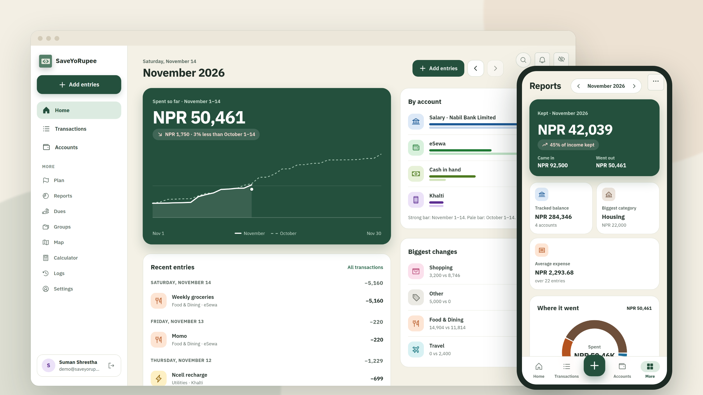
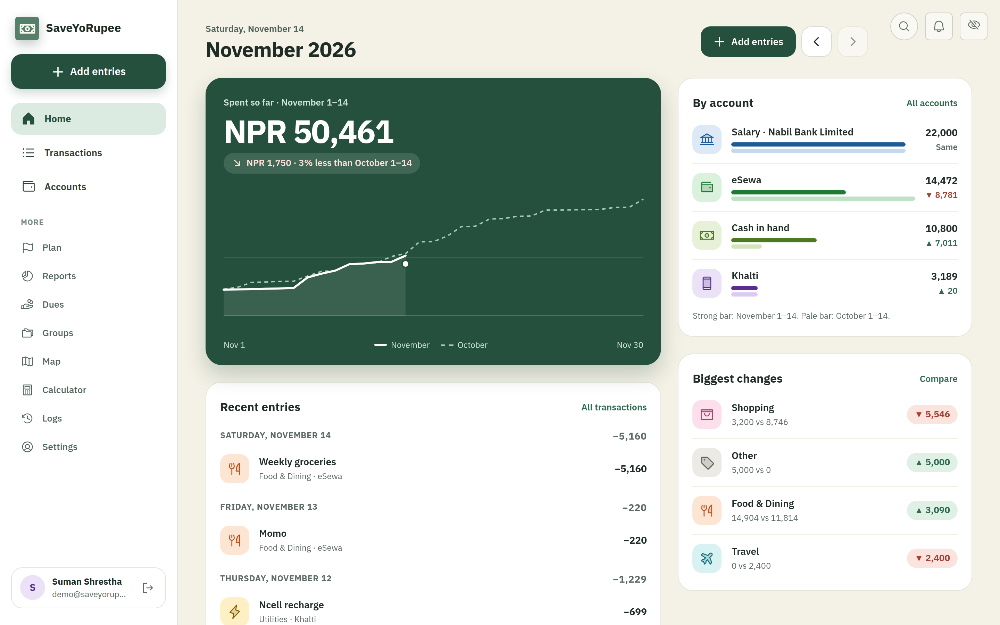
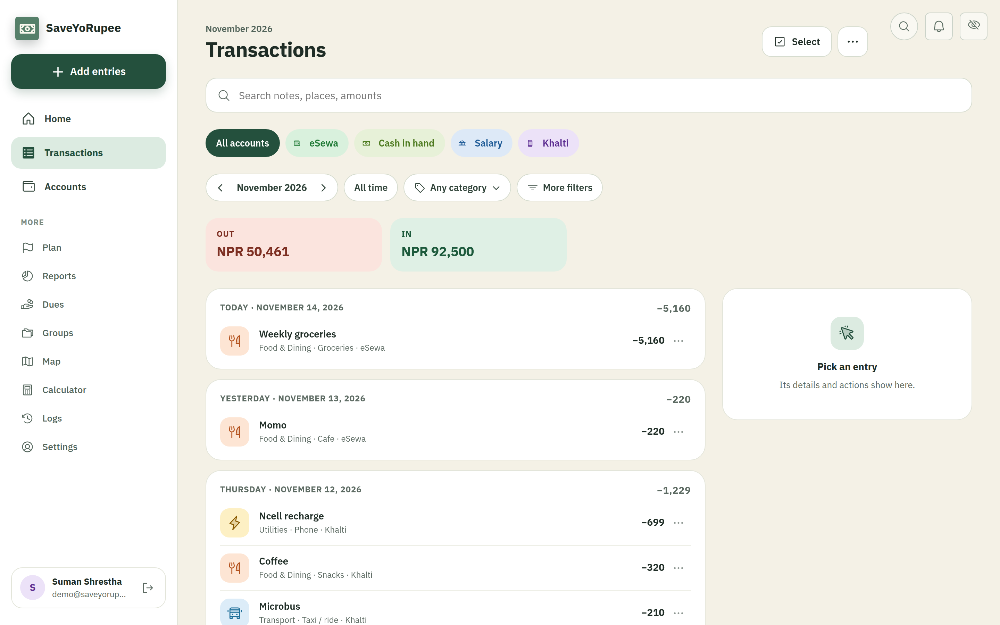
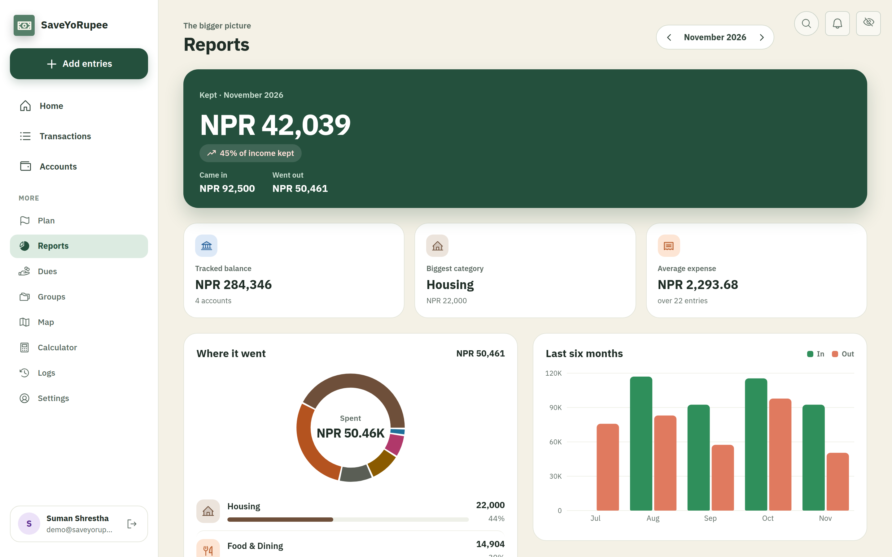
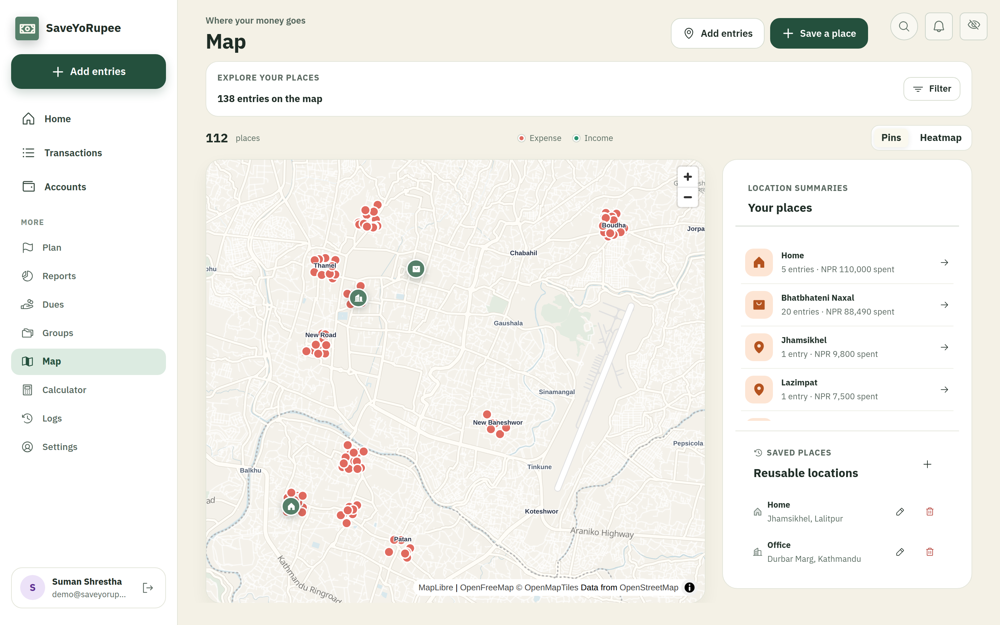
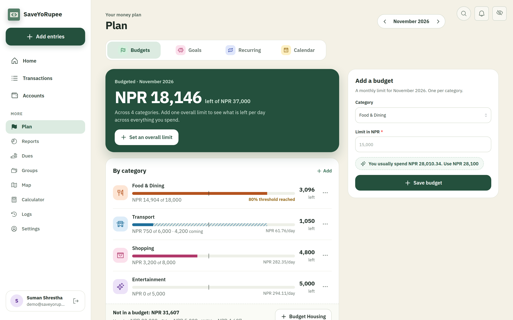
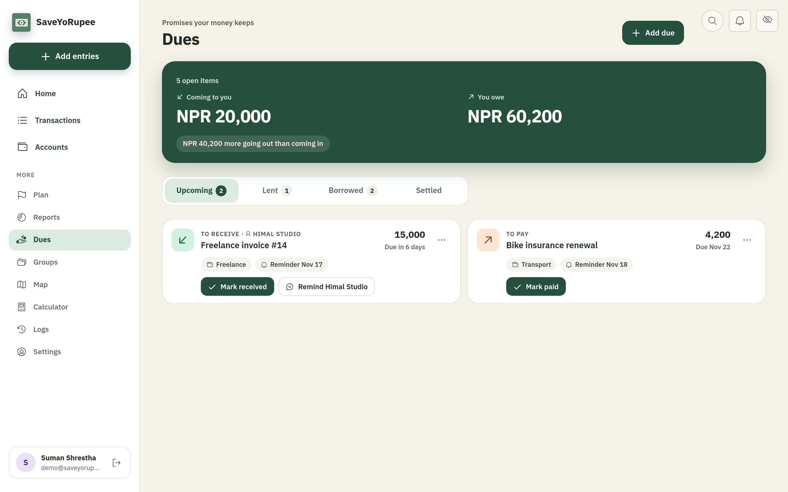
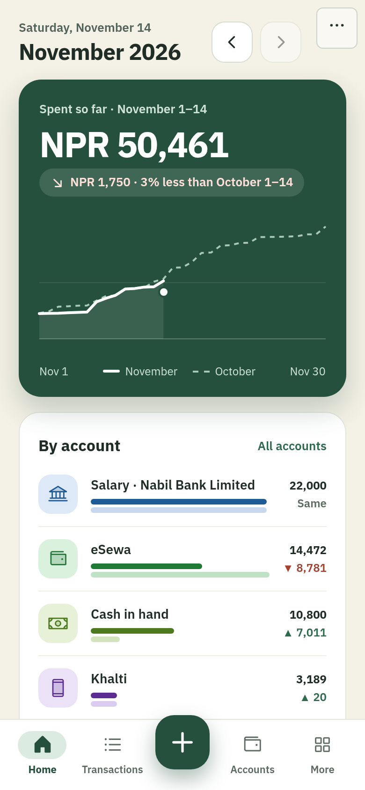
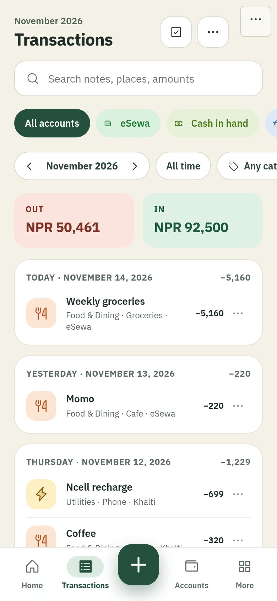
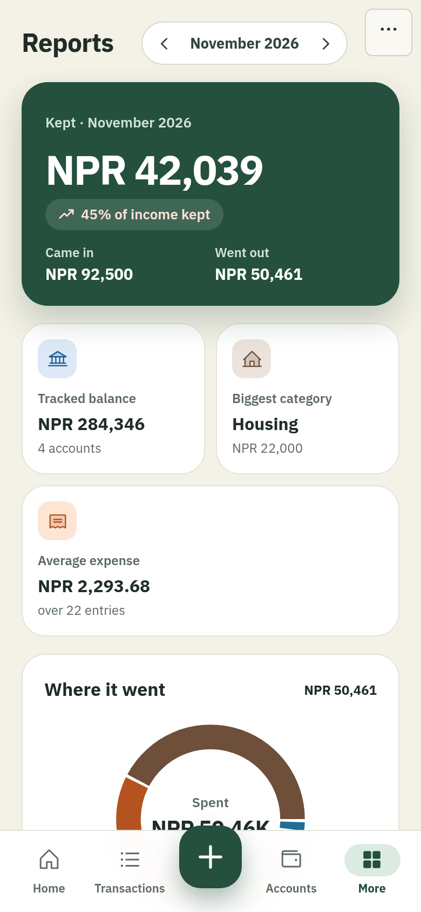

<div align="center">

# SaveYoRupee

**A money tracker made for life in Nepal.**

Log what you spend and earn, see where it goes, and keep your bank, eSewa and Khalti balances honest.
Bikram Sambat dates, the Shrawan–Ashadh fiscal year and Dashain spending are built in, not bolted on.

[**Try it live**](https://expense-tracker-beige-iota.vercel.app) · [Run it yourself](#run-it-yourself) · [What's inside](#whats-inside)



</div>

## Why it exists

Most budgeting apps assume a US bank, a US calendar and a US salary. Here, money arrives as an SMS from Nabil Bank, moves through eSewa, goes out as cash for momo and microbus fares, and the year that matters ends in Ashadh. SaveYoRupee is built around that.

It's a personal ledger, not a bank: nothing connects to your accounts. You add entries yourself (or paste a bank SMS and let the app read it), and the app does the adding up.

## What it does

### See the month at a glance

Home shows how much you've spent so far, how that compares to the same point last month, where each account stands, and which categories moved the most.



### Every entry, easy to find

Search by note, place or amount. Filter by account, category or month. Each day is grouped with its own total, so a busy Saturday is easy to spot.



### Reports that answer "where did it go?"

How much you kept this month, your biggest category, a breakdown of spending and the last six months side by side. Download any month as a PDF.



### A map of your spending

Tag an entry with a place in Kathmandu and it shows up on the map. Save places you return to (home, office, your usual shop) and see what each one costs you.



### Budgets, goals and bills that come back every month

Set a limit per category and see what's left per day. Track savings goals, rent, salary and subscriptions in one place.



### Money you're owed, and money you owe

Keep track of who you lent to, who you borrowed from, and bills coming up. Get a reminder before they're due, record partial payments, and see a payoff plan for what you owe.



### Built for your phone

Everything works on a phone, with the add button always under your thumb. Install it to your home screen like an app.

<p align="center">
  
  &nbsp;
  
  &nbsp;
  
</p>

## What's inside

**Made for Nepal**
- **Paste a bank SMS** and the app fills in the amount, date, merchant and account for you. Common formats are read right in your browser, so the message never leaves your device.
- **Bikram Sambat calendar.** Switch the whole app to BS dates in Settings. Your data is still stored in AD, so exports and bank statements line up.
- **Fiscal year reports** from Shrawan 1 to the end of Ashadh.
- **Festival spending.** See how this Dashain and Tihar compare with last year.
- **Nepali banks and wallets.** eSewa, Khalti, IME Pay, connectIPS, cash, and every licensed commercial and development bank.

**Day-to-day**
- Add several entries at once, by voice, or from a receipt photo.
- Group entries into trips and events, like "Pokhara over Dashain".
- Move money between accounts without it counting as spending.
- Check each account against its real balance once a month, so small mistakes don't pile up.
- Gentle warnings for duplicates and unusually large amounts. Nothing is blocked.

**Planning**
- **Safe to spend:** how much you can spend each day until your next payday, after bills and a buffer you choose.
- **What if:** see how cutting a category changes when you'll reach a savings goal.
- **Payoff plan:** order your debts by smallest first, highest interest first or due date, and see when you'll be clear.

**Your data stays yours**
- Hide amounts with one tap, and lock the app with a PIN.
- Import and export CSV, or download a full backup.
- Delete your account and everything in it, whenever you like.

## Privacy, in plain words

- Your ledger lives in your own database. There are no ads and no trackers.
- A few optional features use Google Gemini: reading a receipt photo, reading a bank statement, reading an SMS the app doesn't recognise, and learning your usual categories. They only run when you press the button, and you always review the result before anything is saved.
- Bank SMS in a familiar format is read on your device and never sent anywhere.
- Gemini's free tier may use what you send to improve Google's products. If you run your own copy, use test data or a paid Gemini plan for real receipts.

## Run it yourself

You'll need **Node 24**, a **PostgreSQL** database (a free [Supabase](https://supabase.com) project works well) and about ten minutes.

```bash
git clone https://github.com/burr1to/expense-tracker.git
cd expense-tracker
cp .env.example .env.local   # then fill it in, see below
npm install
npm run db:deploy            # creates the tables
npm run dev
```

Open http://localhost:3000, sign up, and you're in.

**The minimum `.env.local`:**

| Setting | What it's for |
|---|---|
| `DATABASE_URL` | Your PostgreSQL connection string |
| `BETTER_AUTH_SECRET` | Any long random string, used to sign sessions |
| `BETTER_AUTH_URL` | Where the app runs, e.g. `http://localhost:3000` |

Everything else is optional and switches on a feature when you add it:

| Setting | Turns on |
|---|---|
| `SUPABASE_URL`, `SUPABASE_PUBLISHABLE_KEY`, `SUPABASE_SECRET_KEY` | Attaching receipt photos and PDFs (kept in a private bucket, 3 MB max) |
| `GEMINI_API_KEY` | Receipt scanning, statement import, unfamiliar SMS, personalization. Get a key at [Google AI Studio](https://aistudio.google.com/app/apikey). Keep it server-side, never `NEXT_PUBLIC_`. |
| `GEMINI_DAILY_CAP` | A ceiling on Gemini calls across all users per day |
| `RESEND_API_KEY`, `AUTH_EMAIL_FROM` | Password reset and reminder emails. Without them, reset links print in your terminal. |
| `CRON_SECRET` | The daily reminder run in `vercel.json` (07:00 Nepal time) |
| `NEXT_PUBLIC_MAP_STYLE_URL`, `PHOTON_SEARCH_URL` | A different map style or place search. The defaults are free and need no key. |

Already running an older copy? Run `npm run db:deploy` before starting the new version.

### Checks

```bash
npm run lint
npm test
npm run build
```

## Under the hood

Next.js 16 and React 19 with TypeScript, Prisma 7 on PostgreSQL, Better Auth for accounts, MapLibre with OpenFreeMap tiles, Recharts, and Vitest.

<details>
<summary><strong>How some of it works</strong></summary>

<br>

**Sign-in and ownership.** Email and password through Better Auth, hashed with scrypt, with HTTP-only same-site session cookies stored in the database. Every read and write checks the session on the server and filters by the signed-in user. Changing your password signs out your other sessions. Deleting your account removes all of your data.

**BS dates.** Conversion uses a vetted lookup table, and the tests pin it against published Nepali New Year dates from BS 2000 to 2090, so a bad upgrade fails the build rather than quietly shifting dates. Dates outside that range fall back to AD.

**Festival comparison.** A festival is the BS month it falls in (Dashain is Ashwin, Tihar is Kartik), so no almanac table is needed. If there's nothing from last year, the app says so instead of showing a made-up percentage.

**SMS reading.** A regex parser reads amount, direction, date, merchant, the last digits of the account and the balance, and gives a confidence score. It never guesses: anything it can't read stays blank. Templates for specific banks live in `src/lib/sms-templates.ts`. It ships empty on purpose, so add one when you have real samples from that sender.

**Safe to spend.** Your tracked balance, minus everything due before your next payday, minus your buffer, spread over the days left. Income that hasn't arrived yet isn't counted.

**Account balances.** Each account has a balance you checked by hand on a date. Entries and transfers after that date adjust it. A monthly reconciliation compares the app's number with the real one, records any difference with a note, and locks that month.

**Map.** Exact locations must fall inside the Kathmandu valley. Place search goes through the server with debouncing, caching and rate limiting. Use a hosted or self-hosted Photon as usage grows.

**AI limits.** Per person per Nepal day: 20 receipt scans, 10 statement imports, 50 SMS reads and 5 personalization runs. Personalization sends only place and category names, never amounts, receipts, locations, account details or your email.

</details>

<details>
<summary><strong>CSV import format</strong></summary>

<br>

Required columns: `date`, `type`, `category`, `amount`. Optional: `subcategory`, `area`, `note`, `payment mode` (`cash`, `cheque` or `online`, default `cash`) and `payment account id` (needed for online rows).

```csv
date,type,category,subcategory,area,note,amount,payment mode,payment account id
2026-07-15,expense,Food & Dining,Lunch,Thamel,"Lunch, team",1250,cash,
2026-07-15,income,Salary,Salary,,Monthly salary,85000,cash,
```

You can also import text, PDF or image statements. Those go through Gemini and always land on a review screen first.

Amounts show in NPR, USD or AUD, with no currency conversion.

</details>

<details>
<summary><strong>Connect an AI assistant (MCP)</strong></summary>

<br>

An assistant such as Muse can read your ledger and send bank or wallet notifications for you to review, through the MCP endpoint at `/api/mcp`. It can't add, edit or delete entries: each message waits on Home under "messages from Muse" and only becomes an entry when you save it. You can see and disconnect apps in Settings → Security → Connected apps.

Access uses OAuth 2.1: authorization code with S256 PKCE, a consent screen every time, rotating refresh tokens (reusing one revokes the connection), and only SHA-256 hashes of codes, tokens and secrets are stored. There's no open registration. Register each app once:

```bash
npm run db:deploy
DATABASE_URL=… node scripts/oauth-client.mjs create --name Muse --redirect-uri <the app's OAuth callback URL>
```

It prints `client_id` and `client_secret` once. Give the app:

| Setting | Value |
|---|---|
| Authorize endpoint | `<BETTER_AUTH_URL>/oauth/authorize` |
| Token endpoint | `<BETTER_AUTH_URL>/api/oauth/token` |
| Resource / MCP URL | `<BETTER_AUTH_URL>/api/mcp` |
| Scopes | `ledger:read ledger:draft` |
| Client auth | `client_secret_basic` (or `client_secret_post`) |

Discovery documents are at `/.well-known/oauth-authorization-server` and `/.well-known/oauth-protected-resource/api/mcp`. Use `rotate-secret`, `add-redirect`, `disable` and `list` to manage clients later.

Read tools (`ledger:read`) use the same code as the app's screens and PDF report, so the numbers always agree. Amounts come as `{ minor, text }`; months as `YYYY-MM` or `BS:YYYY-MM`.

| Tool | What it answers |
|---|---|
| `get_ledger_context` | Currency, calendar, today, and the ids for categories, accounts, groups and places |
| `list_transactions`, `list_transfers` | Entries and transfers, filtered by date, category, account, group, amount or text |
| `get_monthly_report` | The PDF report as data, for a month, BS month or fiscal year (`FY:2082-83`) |
| `get_month_overview` | What needs attention: spending vs budget, projected net, safe to spend, budgets at risk, overdue dues, unconfirmed bills |
| `get_accounts` | Balance per account, the total, and the last reconciliation |
| `get_budgets` | Pacing, unbudgeted spending, and last month's limits and actuals |
| `get_dues` | Bills, loans and money owed, with a payoff plan |
| `get_recurring` | Salary, rent and subscriptions, and what's due soon |
| `get_savings_goals` | Progress and the monthly amount needed |
| `get_cash_forecast` | Projected balance and its lowest point (7–90 days) |
| `get_place_trends` | Where spending changed most, place by place |
| `list_groups` | Trips and events with their totals |
| `get_milestones`, `get_activity_log` | Wins, and what changed recently |

Draft tools (`ledger:draft`): `send_for_review` and `list_review_queue`. One-time-code messages are refused, each notification is queued only once, and unreviewed messages are dropped after 30 days.

</details>

---

<sub>Screenshots use made-up data for a made-up person. The map uses © OpenStreetMap contributors via OpenFreeMap.</sub>
